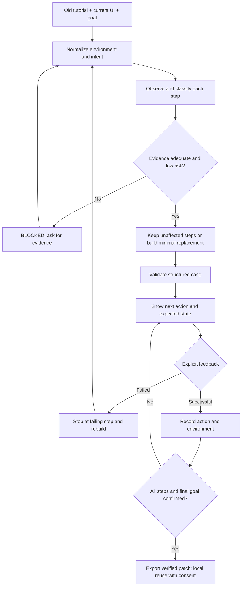

# Workflow

Unknown version/language/context: ask, mark blocked until exact scope known. Blurry/partial screenshot: request relevant crop/transcription. Conflicting evidence: describe conflict, no execution candidate. Risky action: pause and refer to appropriate official guidance. Failure: never try random alternate paths, revise with new evidence; old revision feedback cannot be replayed. A simulation can test the mechanics but can never produce a real VERIFIED record.

## 处理用户更正

用户纠正页面标题时，记录更正后的可见内容，再确认目标。找下载记录时，以下载条目或空列表提示为准。
